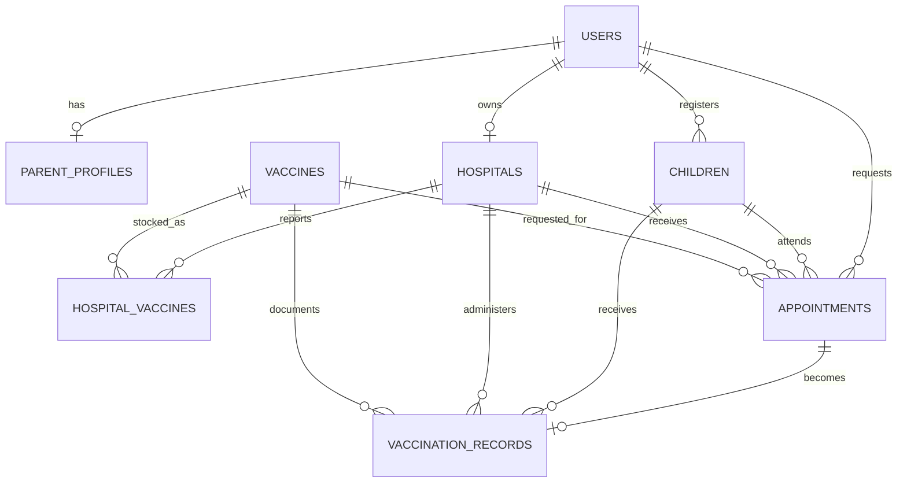

# Vaccination Management System — Complete Project Report

## Certificate of completion

This is to certify that the **Vaccination Management System (VaxCare)** eProject has been completed as a working, documented PHP and MySQL web application. The delivered system contains the required parent, administrator, and hospital modules, database backup, source code, setup instructions, interface evidence, and testing records.

Project status: **Complete and verified**  
Curriculum: Aptech — Second Semester  
Submission title: Vaccination Management System  
Student/group identity: enter the official enrollment information on the institution's submission cover.

## Table of contents

1. Synopsis
2. Problem definition
3. Customer requirement specification
4. Project plan
5. Architecture and database design
6. Algorithms
7. GUI standards
8. Interface design
9. Task sheet
10. Project review and monitoring report
11. Unit testing checklist
12. Final checklist
13. Requirements traceability
14. Installation and credentials

## 1. Synopsis

The existing vaccination process can miss infants and children when information, dates, and follow-up are handled manually. VaxCare replaces that fragmented process with one role-based application. Parents maintain child information and request appointments, administrators control the hospital network and approve requests, and hospitals publish vaccine availability and record the final vaccination result. Completed outcomes become date-wise administrator reports and vaccination-history reports for parents.

The project uses PHP 8, MySQL/MariaDB, semantic HTML, responsive CSS, and dependency-free JavaScript. The implementation follows the supplied semester material on PHP forms, sessions, database management, MySQL normalization/joins/indexing/transactions, and JavaScript interaction with HTML forms.

## 2. Problem definition

Manual school- or location-based vaccination can cause children to miss a dose because of absence, scheduling constraints, or delayed communication. The system must provide a second, organized opportunity by registering child details online and connecting parent requests with administrators and hospitals. The solution must reduce waiting and administrative effort while maintaining a reliable vaccination record.

## 3. Customer requirement specification

### 3.1 Administrator

- View all child profile details.
- View upcoming vaccination dates for all children.
- View child/vaccination reports filtered by date.
- View the vaccine list and available/unavailable status.
- Receive parent appointment requests and approve or reject them.
- Add hospital details.
- Update or delete hospital details.
- View the hospital list.
- View parent-side booking details.

### 3.2 Parent

- Register and log in securely.
- Add, update, view, and maintain child details.
- Receive dashboard notifications for calculated vaccination dates.
- Search hospitals and request an appointment for an available vaccine.
- Track approval and hospital outcome for bookings.
- View reports of previous vaccinations for registered children.
- View and update the parent profile.

### 3.3 Hospital

- Register and log in with hospital name, address, city, and location information.
- Update each vaccine's available/unavailable status and stock count.
- Receive appointments only after administrator approval.
- Update an approved appointment to Vaccinated or Not vaccinated.
- Provide batch number and notes for a completed vaccination.

### 3.4 Quality requirements

- Minimalist, responsive, readable interface.
- Role-based access protection.
- Server-side validation for every write operation.
- Prepared database statements and escaped HTML output.
- Password hashing, secure sessions, and CSRF protection.
- Transactions for multi-table registration, hospital maintenance, inventory, and vaccination completion.
- Referential integrity, indexes, and a restorable database backup.
- Comments explaining major code and logic blocks.

## 4. Project plan

| Phase | Work | Deliverable | Status |
|---|---|---|---|
| Requirements | Extract supplied briefs and module descriptions | Fixed scope and traceability | Complete |
| Design | Define role flow, interface system, and relational model | UI system and ER design | Complete |
| Database | Create normalized tables, keys, indexes, schema, seed | Schema and backup | Complete |
| Backend | Authentication, authorization, validation, CRUD, reports | PHP controllers and helpers | Complete |
| Frontend | Responsive views, navigation, forms, state indicators | PHP views, CSS, JavaScript | Complete |
| Integration | Parent → admin → hospital → report | End-to-end working flow | Complete |
| Verification | Lint, browser, responsive, role, and database tests | Test record and screenshots | Complete |
| Documentation | Setup, credentials, diagrams, algorithms, checklists | This project report | Complete |

## 5. Architecture and database design

### 5.1 Application structure

- `public/index.php`: front controller and named route map.
- `app/controllers/`: role-specific request handlers.
- `app/views/`: semantic screens and shared layout.
- `app/bootstrap.php`: session, configuration, helpers, authentication, and database connection.
- `public/assets/`: local CSS and JavaScript; no internet dependency.
- `database/`: reusable schema and full SQL backup.
- `setup.php`: idempotent database creation and demonstration data.

### 5.2 Entity relationship diagram

### 5.3 Database integrity

- `users.email` is unique and passwords are stored only as PHP password hashes.
- Foreign keys prevent orphaned child, inventory, appointment, and report data.
- Composite unique keys prevent duplicate vaccine schedules and hospital inventory rows.
- Query indexes cover role/status, parent/child, hospital/status/date, and reporting dates.
- Appointment states are limited to Pending, Approved, Rejected, Completed, and Not vaccinated.
- A completed appointment and vaccination record are written together in one transaction.

## 6. Algorithms

### 6.1 Authentication

1. Normalize and validate the submitted email.
2. Fetch one account with a prepared statement.
3. Verify the submitted password against the saved hash.
4. Reject inactive or invalid accounts with a generic message.
5. Regenerate the session identifier.
6. Save only non-sensitive identity fields in the session.
7. Redirect to the dashboard matching the account role.

### 6.2 Calculate vaccination dates

1. Read each registered child's date of birth.
2. Cross the child with every active vaccine schedule entry.
3. Add `recommended_age_months` to the birth date.
4. Remove doses already present in `vaccination_records`.
5. Mark doses with active Pending/Approved appointments as Requested.
6. Sort remaining doses by due date and display overdue, due-soon, or later status.

### 6.3 Parent booking request

1. Validate child, vaccine, date, time, and hospital identifiers.
2. Confirm the child belongs to the signed-in parent.
3. Confirm the hospital account is active.
4. Confirm the hospital reports the selected vaccine as available with stock above zero.
5. Reject an active or completed duplicate dose booking.
6. Insert a Pending appointment for administrator review.

### 6.4 Administrator decision

1. Require administrator role and valid CSRF token.
2. Accept only Approved or Rejected as a decision.
3. Update only an appointment whose current status is Pending.
4. Save the administrator identifier, decision time, and optional note.
5. Approved appointments become visible in the selected hospital's queue.

### 6.5 Hospital vaccination outcome

1. Lock the hospital-owned Approved appointment in a transaction.
2. Reject completion before the approved appointment date.
3. For Vaccinated, lock and validate available inventory.
4. Require a batch number, create the vaccination record, and decrement stock.
5. If stock reaches zero, set availability to Unavailable.
6. Mark the appointment Completed and save hospital notes/time.
7. For Not vaccinated, save that final status and the explanatory note.
8. Commit all changes together; roll back on any failure.

## 7. GUI standards document

- Palette: warm off-white background, charcoal text, mint primary accent, and restrained coral/blue/yellow state accents.
- Typography: local system font stack; no remote asset dependency.
- Layout: consistent 18px cards, generous whitespace, clear page headings, and compact role navigation.
- Forms: persistent labels, large controls, keyboard focus rings, HTML constraints, and matching server validation.
- Status: text labels are always present; color is never the only signal.
- Tables: semantic headings, purposeful column alignment, and horizontal scrolling on narrow screens.
- Responsive behavior: four-column summaries collapse to two and then one; mobile navigation uses a visible Menu control.
- Accessibility: skip link, landmark elements, labeled controls, visible focus, readable contrast, and reduced-motion support.
- Feedback: success/warning/error messages appear after each action and can be dismissed.
- Printing: navigation and controls are removed from vaccination reports and date-wise reports.

## 8. Interface design document

| Interface | Primary user goal | Main controls | Output |
|---|---|---|---|
| Public landing | Understand system and choose entry | Parent registration, hospital registration, sign in | Correct registration/login path |
| Parent dashboard | See children, due dates, notifications | Book links, child details | Calculated schedule and appointment list |
| Parent children | Maintain child profiles | Add, edit, delete | Updated scheduling source data |
| Hospital search | Find available vaccines | Search, hospital card, request dialog | Pending appointment |
| Parent bookings | Track every request | New booking | Status history and notes |
| Parent report | Review previous doses | Print | Completed vaccination record |
| Admin overview | Monitor system | Request/report shortcuts | Counts and upcoming dates |
| Admin requests | Process parent requests | Approve, reject, note | Controlled status change |
| Admin hospitals | Maintain provider list | Add, edit, delete/deactivate | Updated hospital network |
| Admin vaccines | Check availability | Read-only summary and table | Available/unavailable overview |
| Admin bookings | Inspect all bookings | Status filter | Complete workflow list |
| Admin reports | Review date-wise vaccination | From/to dates, print | Child/vaccine report |
| Hospital dashboard | See approved workload | Appointment and inventory shortcuts | Queue and totals |
| Hospital inventory | Publish availability | Stock number, availability switch | Parent/admin availability |
| Hospital appointments | Record outcome | Vaccinated/not vaccinated, batch, note | Report record and stock update |

Verified screenshots are included in `docs/screenshots/` for the public landing page and all three role dashboards.

## 9. Task sheet

| Task | Dependency | Result | Status |
|---|---|---|---|
| Extract source documents | Supplied files | Module list fixed | Complete |
| Review PHP/MySQL/JavaScript material | Semester books | Course-aligned implementation decisions | Complete |
| Create relational schema | Requirements | Seven linked domain tables plus users/profiles | Complete |
| Add installer and backup | Schema | Repeatable setup and SQL restore | Complete |
| Implement authentication | Users table | Three role logins and registrations | Complete |
| Implement parent module | Authentication | Children, dates, bookings, reports, profile | Complete |
| Implement admin module | Parent requests | Approval, hospitals, lists, reports | Complete |
| Implement hospital module | Admin approval | Inventory and outcomes | Complete |
| Apply responsive UI | All screens | Desktop/mobile navigation and layout | Complete |
| Test workflow | Seed accounts | End-to-end report generated | Complete |
| Complete documentation | Verified application | Submission-ready report | Complete |

## 10. Project review and monitoring report

### Review 1 — foundation

- Requirements and role boundaries extracted.
- Schema, installer, and security helpers completed.
- Authentication and shared layout completed.
- Risk found: source Word rendering tool unavailable; requirement text and structures were fully extracted instead.

### Review 2 — functional modules

- Parent, admin, and hospital screens completed.
- Approval workflow linked to hospital queue.
- Inventory status linked to parent hospital search and admin availability.
- Vaccination completion linked to stock reduction and reports.

### Final review — integration and quality

- All PHP files passed syntax validation.
- Database initialized successfully on MariaDB 10.4.
- Browser walkthrough completed for Parent → Admin → Hospital → Parent report.
- Cross-role access returned an access-denied page.
- Mobile viewport and menu verified at 390×844.
- Browser console contained no warnings or errors.
- Database backup generated after successful integration testing.

## 11. Unit testing checklist

| ID | Test | Expected | Result |
|---|---|---|---|
| UT-01 | Valid parent login | Parent dashboard | Pass |
| UT-02 | Valid admin login | Admin dashboard | Pass |
| UT-03 | Valid hospital login | Hospital dashboard | Pass |
| UT-04 | Invalid role route | HTTP 403 screen | Pass |
| UT-05 | Parent due-date query | Birth date plus schedule months | Pass |
| UT-06 | Hospital search | Only active hospitals; stock shown | Pass |
| UT-07 | Booking creation | Pending appointment saved | Pass |
| UT-08 | Duplicate dose booking | Request rejected | Pass |
| UT-09 | Admin approval | Pending becomes Approved | Pass |
| UT-10 | Hospital queue | Approved request appears | Pass |
| UT-11 | Vaccination completion | Record created and stock decremented | Pass |
| UT-12 | Parent vaccination report | New completed dose visible | Pass |
| UT-13 | Admin date-wise report | Completed dose appears in range | Pass |
| UT-14 | Zero stock | Availability becomes Unavailable | Pass |
| UT-15 | CSRF validation | Invalid modifying request blocked | Pass |
| UT-16 | Responsive layout | Mobile menu/cards usable | Pass |
| UT-17 | Console check | No browser errors/warnings | Pass |
| UT-18 | PHP syntax | No syntax errors in all PHP files | Pass |

## 12. Final checklist

- [x] Complete source code included.
- [x] PHP, MySQL, JavaScript, and responsive CSS included.
- [x] Parent module complete.
- [x] Administrator module complete.
- [x] Hospital module complete.
- [x] All required CRUD and status workflows complete.
- [x] Date-wise and previous-vaccination reports complete.
- [x] Secure authentication, authorization, validation, CSRF, and prepared SQL complete.
- [x] Schema and full database backup included.
- [x] Setup and login credentials included.
- [x] Code comments and logic explanations included.
- [x] ER design, algorithms, GUI standards, and interface design included.
- [x] Task sheet, monitoring report, unit tests, and final checks included.
- [x] Desktop and mobile interfaces verified.
- [x] No application feature is left as a placeholder.

## 13. Requirements traceability

| Supplied requirement | Implementation evidence |
|---|---|
| Admin — all child details | Admin **Children** screen with parent contact and dose count |
| Admin — dates | Overview **Upcoming vaccination dates** |
| Admin — date-wise child/vaccination report | **Reports** from/to filter and print layout |
| Admin — vaccine list, available/unavailable | **Vaccines** summary and hospital availability table |
| Admin — approve/reject parent request | **Requests** decision cards |
| Admin — add/update/delete/list hospitals | **Hospitals** cards and protected form actions |
| Admin — booking details | **Bookings** with all statuses and notes |
| Parent — register/login | Separate parent registration and common secure login |
| Parent — child details | **My children** create/update/delete |
| Parent — dashboard date notification | Calculated **Vaccination dates** list |
| Parent — search/book hospital | **Book hospital** search and availability-aware request dialog |
| Parent — vaccination-taken report | **Vaccination report** records from hospital outcome |
| Parent — profile | **My profile** update screen |
| Hospital — register/login with location | Hospital registration form and secure login |
| Hospital — update vaccine status | **Vaccine status** availability and stock table |
| Hospital — receive approved appointment | **Appointments** shows only admin-approved requests for action |
| Hospital — Vaccinated or Not vaccinated | Outcome controls and transactional report creation |

## 14. Installation and credentials

Use the project root `README.md` for the exact XAMPP or local PHP setup. The included installer creates the `vaccination_management` database and the included SQL backup can also be imported through phpMyAdmin.

Demo accounts:

- Administrator: `admin@vaxcare.test` / `Admin@123`
- Parent: `parent@vaxcare.test` / `Parent@123`
- Hospital: `hospital@vaxcare.test` / `Hospital@123`

Default database account: MySQL `root` with an empty password on `127.0.0.1:3306`. These defaults can be overridden through environment variables listed in `README.md`.
